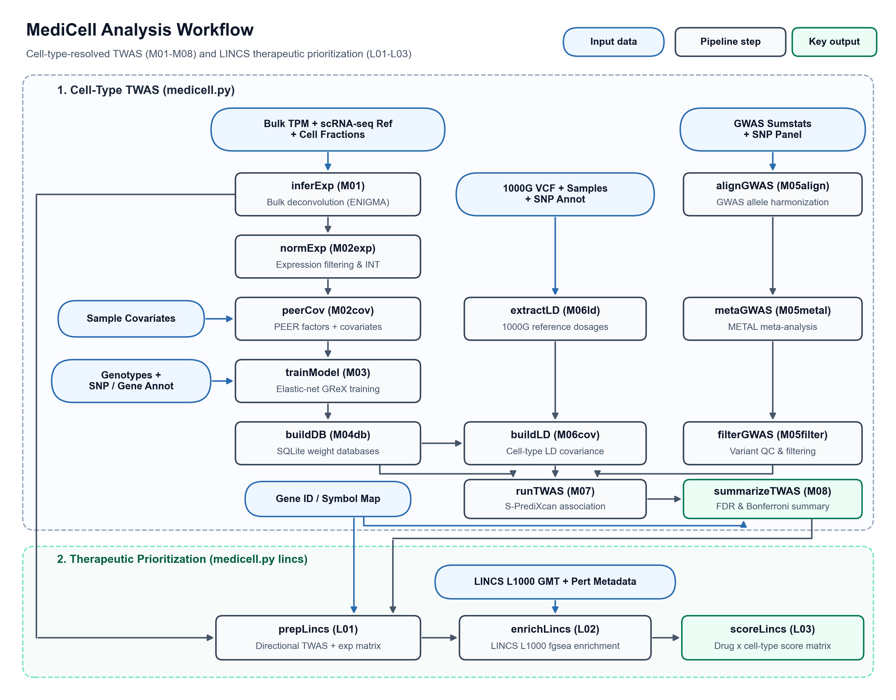

# MediCell

MediCell is an integrative TWAS framework that combines single-cell reference
profiles with bulk transcriptomic and genotype data to identify
cell-type-dependent genetic effects. It deconvolves bulk RNA-seq into
cell-type-resolved expression via CIBERSORTx + ENIGMA, trains
cell-type-specific genetically regulated expression (GReX) models with
elastic-net, and performs S-PrediXcan association against GWAS summary
statistics. For downstream therapeutic discovery, `medicell.py lincs` integrates
cell-type TWAS associations and expression profiles with LINCS L1000
perturbational signatures (`fgsea`) to prioritize candidate therapeutic
perturbations per cell type.


## Workflow




## Installation

Requirements: an `x86_64` Linux system with `conda`. The software is pre-packaged
and ready to run directly after unpacking and creating the conda environments.

1. Download and unpack the release archives from GitHub Releases:

```bash
tar xzf medicell-software.tar.gz
tar xzf medicell-ref-data.tar.gz -C MediCell/data
cd MediCell
```

This creates `MediCell/` with the reference databases placed at `MediCell/data/ref/`
(`data/ref/lincs/LINCS_PRL_top250_human.gmt`, `LINCS_PRL_top250.gmt`,
`GSE92742_Broad_LINCS_pert_info.txt.gz`, and `GSE70138_Broad_LINCS_pert_info_2017-03-06.txt.gz`).

2. Create the three runtime conda environments:

```bash
conda env create -f envs/R4.4.3.yml
conda env create -f envs/r3.6.3.yml
conda env create -f envs/imlatools.yml
```

| Component | Location / Name | Description |
|---|---|---|
| conda env `R4.4.3` | `envs/R4.4.3.yml` | R 4.4.3 runtime for ENIGMA, elastic-net training, SQLite DBs, GWAS processing, and `fgsea` LINCS enrichment |
| conda env `r3.6.3` | `envs/r3.6.3.yml` | Legacy R 3.6.3 runtime for PEER hidden-factor estimation |
| conda env `imlatools` | `envs/imlatools.yml` | Python 3.10 runtime for MetaXcan / S-PrediXcan and `bcftools` |
| Bundled binaries & libraries | `tools/` | Pre-built `METAL`, `MetaXcan`, `ENIGMA` (`tools/R_libs/R4.4.3`), and `PEER` (`tools/R_libs/r3.6.3`) loaded automatically by `medicell.py` |
| Reference databases | `data/ref/` | Extracted from `medicell-ref-data.tar.gz` into `MediCell/data/` (`data/ref/lincs/...` for `medicell.py lincs`) |

## Usage

### 1. Cell-type TWAS

#### Required data

- **Cohort & sequencing data (self-prepared):**
  - **Bulk RNA-seq** expression matrix (`--bulk-tpm`, TPM) and **matched individual genotypes** (`--genotype-pattern`, dosage `[0, 2]` + SNP annotations `--snp-annot-pattern` / `--snp-annot-file`) from the same individuals, along with **sample covariates** (`--covariates`, e.g., PCs, sex, age, batch).
  - **Tissue-matched scRNA-seq reference** (`--enigma-ref`, cell-type-aggregated TPM) and **cell-type fractions** (`--cibersortx-frax`, externally estimated via [CIBERSORTx](https://cibersortx.stanford.edu/)).
  - **GWAS summary statistics** (`--gwas-manifest` or `--gwas-summary`) for the target trait/disease (e.g., from the [NHGRI-EBI GWAS Catalog](https://www.ebi.ac.uk/gwas/) or published studies).
- **Public reference data (download & match genome build / GWAS ancestry):**
  - **1000 Genomes Phase 3 VCFs & sample panel** (`--g1000-vcf-pattern`, `--g1000-samples` matched to GWAS ancestry): [1000 Genomes Phase 3 FTP/HTTPS release](https://ftp.1000genomes.ebi.ac.uk/vol1/ftp/release/20130502/) (including per-chromosome VCFs and `integrated_call_samples_v3.20130502.ALL.panel`).
  - **Gene annotations & ID mapping** (`--gene-annot`, `--gene-pos`): [GENCODE Human](https://www.gencodegenes.org/human/) ([GRCh37 Release 19](https://www.gencodegenes.org/human/release_19.html)) or Ensembl archive matching your assembly (`GRCh37` / `GRCh38`).

#### Quick start

Run the full cell-type TWAS pipeline end-to-end:

```bash
python3 medicell.py --output-dir run_out --cell-type-twas \
    --cores 4 \
    --cell-types B,CD4T,CD8T,NK,Mono,DC \
    --peer-nk 2 --peer-keep 2 \
    --training-population POP --gwas-population POP \
    --bulk-tpm           data/bulk_TPM.txt \
    --enigma-ref         data/sc_reference_TPM.matrx \
    --cibersortx-frax    data/CIBERSORTx_fractions.txt \
    --covariates         data/covariates.txt \
    --snp-annot-pattern  data/snp_annot.chr{chr}.txt \
    --genotype-pattern   data/genotype.chr{chr}.txt \
    --gene-annot         data/gene_annot.parsed.txt \
    --snp-annot-file     data/snp_annotation.txt \
    --gwas-manifest      data/gwas_manifest.tsv \
    --g1000-vcf-pattern  data/1000G/ALL.chr{chr}.phase3...genotypes.vcf.gz \
    --g1000-samples      data/POP_samples.txt \
    --gene-pos           data/gene_pos_grch37.82.csv
```

Every input path pattern takes a `{chr}` placeholder that the driver expands
per chromosome (1–22 by default). The covariates file is required for `peerCov` (`M02cov`, format below).

#### Run modes

Use `--cell-type-twas` to run cell-type TWAS (or omit step selectors). To run a
single step or a subset, use the descriptive step flags (`--inferExp`,
`--summarizeTWAS`, etc.), positional subcommand (`medicell.py inferExp ...`),
or `--steps`:

```bash
# Run only ENIGMA expression inference (M01)
python3 medicell.py --inferExp --output-dir run_out --cell-types B,CD4T \
    --bulk-tpm data/bulk_TPM.txt --enigma-ref data/sc_reference_TPM.matrx \
    --cibersortx-frax data/CIBERSORTx_fractions.txt

# Run only the TWAS summary step (M08), using existing TWAS results in run_out
python3 medicell.py --summarizeTWAS --output-dir run_out --cell-types B \
    --gene-pos data/gene_pos_grch37.82.csv

# Combine multiple step flags (or use --steps normExp,peerCov)
python3 medicell.py --normExp --peerCov --output-dir run_out --cell-types B \
    --peer-nk 2 --peer-keep 2 --covariates data/covariates.txt
```

`--cell-type-twas`, `--steps`, and `--<step>` flags are mutually exclusive (combining
multiple `--<step>` flags is supported). Selected steps always execute in
pipeline order, regardless of argument order; duplicates run only once.
Only selected steps run: prerequisites are **not** run automatically.

Canonical step names (all legacy `M01`–`M08` / `M06` / `M04*` / `M05*` names
remain valid aliases in `--steps`):

| Step (`--<step>`) | Legacy alias | Script | Required data arguments |
|---|---|---|---|
| `inferExp` | `M01` | `M01_ENIGMA.R` | `--bulk-tpm`, `--enigma-ref`, `--cibersortx-frax` |
| `normExp` | `M02exp` | `M02_DataProcess_exp_fordb.R` | (uses `inferExp` output) |
| `peerCov` | `M02cov` | `M02_DataProcess_covariance_for_db.R` | `--covariates` |
| `trainModel` | `M03` | `M03_ModelTraining.R` | `--snp-annot-pattern`, `--genotype-pattern`, `--gene-annot` |
| `buildDB` | `M04db`, `M06` | `M04_Makedb.R` | (uses `trainModel` output) |
| `alignGWAS` | `M05align`, `M04align` | `M05_DataProcess_GWAS_align4METAL.R` | `--snp-annot-file`, `--gwas-manifest`, `--gwas-id` |
| `metaGWAS` *(optional)* | `M05metal`, `M04metal` | `M05_DataProcess_GWAS_metal.sh` | (multi-study meta; skipped with `--skip-gwas-meta` or `--gwas-summary`) |
| `filterGWAS` *(optional)* | `M05filter`, `M04filter` | `M05_DataProcess_GWAS_metal_filter.R` | (post-meta QC; skipped with `--skip-gwas-meta` or `--gwas-summary`) |
| `extractLD` | `M06ld`, `M05ld` | `M06_LD.sh` | `--snp-annot-pattern`; also `--g1000-vcf-pattern`, `--g1000-samples` unless `--ld-dosage-dir` |
| `buildLD` | `M06cov`, `M05cov` | `M06_Makeld.sh` | (uses `buildDB` + `extractLD` output) |
| `runTWAS` | `M07` | `M07_TWAS.sh` | (uses `buildDB` + `buildLD` + `filterGWAS` / `--gwas-summary`) |
| `summarizeTWAS` | `M08` | `M08_ResultStatistic.R` | `--gene-pos` |

Other steps use upstream results and need no additional original data
arguments. For multiple steps, provide the union of their required inputs.
Existing tool and environment options still apply.

#### GWAS modes

For raw/multi-cohort GWAS inputs, `alignGWAS` / `metaGWAS` / `filterGWAS` (`M05align`/`M05metal`/`M05filter`) use an explicit manifest (`--gwas-manifest`):

- `--gwas-manifest FILE` — TSV with one row per GWAS study and the exact columns:

  ```
  study_id  path  build  effect_scale  chr_col  pos_col  ea_col  oa_col
  effect_mode  effect_col  se_col  p_col  eaf_col  n_mode  n_value  n_col
  ```

  `path` must be absolute; `effect_scale` is `linear` or `log_odds`;
  `effect_mode` is `beta_se`, `or_se` (SE of the log-OR) or `or_p` (SE
  back-computed from OR and P); `n_mode` is `none`, `constant` (`n_value`)
  or `column` (`n_col`). Unused optional columns are left empty. Runs produce
  the `{gwas_id}_meta` output prefix and filter policy `none` by default.

`metaGWAS` and `filterGWAS` are **optional** and only needed for multi-study
meta-analysis (e.g., combining multiple GWAS cohorts). A pre-QC'd single-study
GWAS can run either:

- directly with `--cell-type-twas --gwas-summary FILE --gwas-id TRAIT` (automatically skips
  `alignGWAS`, `metaGWAS`, and `filterGWAS`; `FILE` must include columns
  `MarkerName`, `Allele1`, `Allele2`, `Effect`, `StdErr`, `P-value`), or
- with `--cell-type-twas --gwas-manifest SINGLE_STUDY.tsv --skip-gwas-meta --gwas-id TRAIT`
  (runs `alignGWAS` to harmonize alleles against `--snp-annot-file` and skips
  `metaGWAS` / `filterGWAS`).

The active mode is recorded in `M04_gwas/gwas_run.json`, so re-running
`metaGWAS`/`filterGWAS`/`runTWAS` in the same output directory recovers it.
`--gwas-id` is a trait label used in output names and reports.

#### Explicit analysis configuration

- `--cell-types` is always required and must match the reference cell-type names.
- `--peer-nk` and `--peer-keep` are required only for `peerCov` (`M02cov`). Use `0`/`0`
  for known covariates only; no PEER factors are inferred in this mode.
- `--twas-model-set filtered-signif|unfiltered` (default `filtered-signif`) selects the database for `runTWAS` (`M07`). `buildDB` always retains `{ct}_models_unfiltered.db` for `buildLD` SNP lookup and generates `{ct}_models_filtered_signif.db` by filtering whole genes (`R^2 > 0.01` and CV `p < 0.05`, dropping unqualified genes entirely).
- `--training-population` is optional metadata for `buildDB` (default `unspecified`).

Sample IDs default to exact matching and gene annotations default to the
standard schema. Old inputs requiring R-style sample names or a missing
`gene_id` column must explicitly select `--sample-id-policy legacy-rnames`
or `--gene-annot-format legacy-name-is-id`, respectively. Use separate output
directories for separate cohorts. `--ld-panel-id` names the LD panel independently
of the training population.

#### Parameters

`--cell-types` and `--output-dir` are always required. Data inputs are required
according to the selected steps above; tuning options retain their defaults:

| Parameter | Description |
|---|---|
| `--output-dir` | run directory; all results are written here |
| `--bulk-tpm` | bulk TPM expression matrix (genes x samples) |
| `--enigma-ref` | single-cell reference matrix (TPM, aggregated by cell type) |
| `--cibersortx-frax` | externally estimated CIBERSORTx cell-type fractions passed into `inferExp` (ENIGMA) instead of internal fraction estimation |
| `--covariates` | covariates txt, first column = sample ID, then covariate columns (required for `peerCov`; format below) |
| `--cat-covs` | comma-separated categorical covariate columns to dummy-encode (default none) |
| `--min-level-count` | drop categorical levels with fewer samples (default 5) |
| `--peer-nk` | PEER hidden factors per cell type; explicit value required for `peerCov` |
| `--peer-keep` | PEER factors kept; explicit value required for `peerCov`; must be ≤ `--peer-nk` |
| `--snp-annot-pattern` | per-chromosome SNP annotation, with `{chr}` placeholder |
| `--genotype-pattern` | per-chromosome genotype dosage, with `{chr}` placeholder |
| `--gene-annot` | gene annotation (TSS-collapsed `start == end`, or with `strand`/`tss` column to resolve TSS) |
| `--snp-annot-file` | single-file genotype panel SNP annotation (for GWAS align) |
| `--g1000-vcf-pattern` | 1000 Genomes Phase 3 VCF pattern, with `{chr}` placeholder |
| `--g1000-samples` | 1000G sample list **matching the GWAS ancestry** (e.g., use 1000G EUR samples for a EUR GWAS, or matched EUR+EAS samples for trans-ancestry EUR+EAS meta-GWAS) |
| `--gene-pos` | gene position annotation CSV (GRCh37, with gene_id/gene_name columns) |

Input contracts:

| Parameter | Description |
|---|---|
| `--sample-id-policy` | `exact` (default) or explicitly selected `legacy-rnames` |
| `--cov-layout` | `auto`, `samples` or `covariates` (default auto) |
| `--gene-annot-format` | `standard` (default) or explicitly selected `legacy-name-is-id` |
| `--genome-build` | `GRCh37` (default) or `GRCh38`; declared for this cohort's coordinates, no liftover is performed |
| `--training-population` | optional population label stored with the trained models (default `unspecified`) |
| `--gwas-population` | GWAS ancestry label (e.g. `EUR`, `EAS`, `EUR_EAS`); sets default `--ld-panel-id` when omitted |
| `--ld-panel-id` | LD panel id matched to GWAS ancestry (defaults to `--gwas-population` if set, else `EUR_EAS`) |
| `--twas-model-set` | `filtered-signif` (default; gene-level filter `R^2 > 0.01` & CV `p < 0.05`) or `unfiltered` for `runTWAS`; `buildDB` always retains `unfiltered` DB for `buildLD` |
| `--maf` | MAF threshold for `trainModel` genotypes in `[0, 0.5]` (default `0.01`; manuscript used `0.05`) |
| `--maf-policy` | `filter` (drop variants `< --maf`) or `verify` (fail if input genotype violates `--maf`) |

##### Covariates file format

Tab- or space-separated with a header. Two layouts are auto-detected:

- **Recommended**: rows = samples, first column = sample ID, then one covariate
  column each. Numeric columns pass through as-is.
- **Legacy** (OneK1K-style): rows = covariates, columns = samples, first column
  = covariate names.

Columns listed in `--cat-covs` are treated as categorical and dummy-encoded,
and levels with fewer than `--min-level-count` samples are dropped.

```
id	age	sex	pc1	...	RIN	Sclerosis	Batch
sample1	54	0	0.01	...	7.2	0.15	3
sample2	47	1	-0.02	...	6.8	0.04	1
```
To reuse a phenotype table stored in an RData file (e.g. the kidney
`QTLData.RData` with `AAglomPhe2`/`AAtubPhe2`), export it once:

```r
load("QTLData.RData")
# put numeric covariates first, then the categorical ones you will list in --cat-covs
write.table(cbind(id = rownames(AAglomPhe2), AAglomPhe2),
            "glom_covariates.txt", sep = "\t", quote = FALSE)
```

then run with `--covariates glom_covariates.txt --cat-covs Pairend,Gender,Batch`.

Run control:

| Parameter | Description |
|---|---|
| `--alpha` | ENIGMA alpha (default 0.1) |
| `--tpm-min` | `normExp` gene filter: min inferred TPM (default 0.1) |
| `--min-pct` | `normExp` gene filter: min sample fraction, 0–1 (default 0.01) |
| `--min-samples` | `normExp` gene filter: min sample count floor (default 5) |
| `--cell-type-twas` | run the full cell-type TWAS pipeline (all 12 TWAS steps; default when no step selector is specified) |
| `--steps STEP [STEP ...]` | run a subset in pipeline order; space/comma-separated; old `M01`–`M08` names are aliases |
| `--<step>` | single-step flags (e.g. `--inferExp`, `--summarizeTWAS`), combinable across steps |
| `--chromosomes` | comma-separated chromosomes (default 1–22) |
| `--cell-types` | explicit space/comma-separated cell-type list; required |
| `--cores` | unified parallel cores/workers across all pipeline steps (default 4) |
| `--seed` | explicit `trainModel` seed; forces serial inner training (`--training-cores 1`) |
| `--training-cores` | inner `trainModel` cores per `(cell_type, chr)` job (defaults from `--cores`) |
| `--ld-dosage-dir` | reuse pre-extracted 1000G dosages, skip `extractLD` (`M06ld`) extraction |
| `--gwas-id` | trait label (required for `--gwas-manifest` and standalone `summarizeTWAS` without `gwas_run.json`; auto-recovered from `gwas_run.json` when present) |
| `--gwas-summary` | pre-QC'd GWAS summary for `runTWAS` (`M07`); automatically skips `alignGWAS`/`metaGWAS`/`filterGWAS` when used with `--cell-type-twas` |
| `--skip-gwas-meta` | skip optional `metaGWAS`/`filterGWAS` for a single pre-QC'd study in `--gwas-manifest` |

Environment/tools (defaults match `envs/*.yml` and bundled `tools/`):

| Parameter | Description |
|---|---|
| `--r-env` / `--peer-env` / `--py-env` | conda envs (default `R4.4.3` / `r3.6.3` / `imlatools`) |
| `--metaxcan-dir` | MetaXcan checkout (default `tools/MetaXcan`) |
| `--metal-bin` | METAL binary (default `tools/METAL/metal`) |
| `--bcftools` / `--bcf-plugins` | bcftools executable / plugin dir |

`trainModel` (`M03`) always uses the bundled training core, `script/helpers/gtex_v7_nested_cv_elnet.R`.

#### Pipeline steps

Executed in dependency order (canonical names; legacy aliases in parentheses):

| Step | What it does |
|---|---|
| `inferExp` (`M01`) | ENIGMA trace-norm deconvolution using externally estimated CIBERSORTx cell fractions |
| `normExp` (`M02exp`) | filter low-expression genes (TPM > `--tpm-min` in `max(--min-pct x N, --min-samples)` samples), per-gene inverse-normal transform per cell type |
| `peerCov` (`M02cov`) | PEER factors + covariates for model training (parallelized across cell types) |
| `trainModel` (`M03`) | nested-CV elastic-net GReX models (parallelized across cell types x chromosomes and genes) |
| `buildDB` (`M04db`, `M06`) | build `{ct}_models_unfiltered.db` (kept for `buildLD` SNP lookup) and gene-filtered `{ct}_models_filtered_signif.db` (`R^2 > 0.01`, CV `p < 0.05`; whole failed genes removed) |
| `alignGWAS` (`M05align`, `M04align`) | align GWAS study/studies to the genotype panel (and write direct TWAS input when meta is skipped) |
| `metaGWAS` (`M05metal`, `M04metal`) | *(optional)* METAL inverse-variance meta-analysis for multi-study GWAS |
| `filterGWAS` (`M05filter`, `M04filter`) | *(optional)* post-meta heterogeneity/direction filtering (policy-dependent) |
| `extractLD` (`M06ld`, `M05ld`) | 1000G dosages for GWAS-ancestry-matched samples aligned to the panel annotation (parallelized across chromosomes) |
| `buildLD` (`M06cov`, `M05cov`) | LD covariance matrices per cell type (parallelized across cell types) |
| `runTWAS` (`M07`) | S-PrediXcan association per cell type (parallelized across cell types) |
| `summarizeTWAS` (`M08`) | per-cell-type FDR / Bonferroni result summary |

`trainModel` dominates total runtime (roughly proportional to cell types x
chromosomes). `--cores` parallelizes both `(cell_type, chromosome)` jobs and
inner gene training, and `--steps` / `--chromosomes` can also split disjoint
subsets across separate sessions into the same output directory.

`buildDB` (`M04db`) accepts only the current 24-column `trainModel` summaries with
explicit `gene_name` and `gene_id`. Old 23-column summaries are rejected; rerun
`trainModel` rather than relying on automatic column repair. The significant-model thresholds
remain `zscore_pval < 0.05` and `rho_avg_squared > 0.01`. No intermediate
`{ct}_models.db` is created. Existing cached databases are not deleted.

#### Outputs

```
{output-dir}/
  M01_deconvolution/    enigma.cse.trace_alpha_{alpha}.RData    deconvolved expression array
                        myenigma_alpha_{alpha}.RData           fitted ENIGMA object
  M02_expression/       {ct}_transformed_expression.txt         filtered + INT expression, samples x genes, sample IDs retained
  M02_covariates/       {ct}_covariates.txt                     covariates used by M03
                        {ct}_peer_res.RData                     raw PEER factors
  M03_models/summary/   Model_training_{ct}_chr{n}_model_summaries.txt
                        Model_training_{ct}_chr{n}_summary.txt
  M03_models/weights/   Model_training_{ct}_chr{n}_weights.txt
  M06_databases/        {ct}_models_unfiltered.db               all models; required for LD covariance and unfiltered TWAS
                        {ct}_models_filtered_signif.db          gene-filtered models (R^2 > 0.01, CV p < 0.05; default for runTWAS)
  M04_gwas/             gwas_run.json                           recorded GWAS configuration
                        {gwas_id}_meta1.tbl                     METAL meta-analysis result
                        {gwas_id}_meta_filt.tsv                 filtered meta-analysis statistics
  M05_ld/dosage/        chr{n}_{panel}.txt.gz                   1000G panel dosages
  M05_ld/cov_{panel}/   chr{n}.txt.gz                           dosages aligned to the panel
                        {ct}.txt.gz                             LD covariance per cell type
  M07_twas/             {ct}.csv                                per-cell-type S-PrediXcan associations
                        {ct}.log
  M08_summary/          allcelltype_result.csv                   all associations with FDR / Bonferroni columns
                        Bonfsig_allcelltype_result.csv          Bonferroni-significant genes
                        FDRsig_allcelltype_result.csv           FDR-significant genes
                        BonFDRsig_allcelltype_result.csv        union of both
```

`{ct}` = cell type, `{n}` = chromosome, `{alpha}` = the `--alpha` value,
`{panel}` = `--ld-panel-id`. Called helper scripts live in `script/helpers/`;
the step entry scripts stay in `script/`.

### 2. Therapeutic prioritization with LINCS

Downstream therapeutic prioritization is invoked separately via `medicell.py lincs` (or `medicell.py --lincs`).
It connects cell-type-resolved TWAS results and cell-type expression profiles
with LINCS L1000 perturbation signatures (`fgsea`) to score candidate compounds
for each cell type:

1. **`prepLincs` (`L01`, `script/L01_lincs_prepare.R`)**: Splits TWAS summary
   statistics by z-score sign (`pos`: `zscore > 0`, `neg`: `zscore < 0`) and
   builds a gene-symbol x cell-type expression matrix (either from `--exp-matrix`
   or by averaging `inferExp` ENIGMA `enigma.cse.test` across samples per cell type).
2. **`enrichLincs` (`L02`, `script/L02_lincs_enrichment.R`)**: Runs `fgsea` on
   the ranked directional TWAS genes against `data/ref/lincs/LINCS_PRL_top250_human.gmt`
   (or a custom `--lincs-gmt`), annotates hits with L1000 Phase 1/2 perturbation
   metadata (`GSE92742` and `GSE70138` in `data/ref/lincs/`), and filters hits by
   significance and NES sign (default `NES < 0`, `pval < 0.05`).
3. **`scoreLincs` (`L03`, `script/L03_lincs_drug_score.sh`)**: Selects the top
   perturbations per run, extracts their leading-edge genes and per-cell-type
   TWAS z-scores, computes cross-cell-type expression specificity (`expZscore`),
   and sums `RankScore = |TWAS_zscore| * expZscore` over each drug's
   leading-edge genes to produce a drug x cell-type prioritization matrix.

Called helper scripts reside in `script/helpers/` (`lincs_fgsea_lib.R`,
`lincsTissueSpecific.R`, `formatLeadingSpecific.pl`, `formatZscoreSpecific.pl`,
`getZscoreSpecificMatrix.R`). The `R4.4.3` environment defined in `envs/R4.4.3.yml` includes `fgsea`,
`dplyr`, `tidyr`, `data.table`, and `readxl` (for `.xlsx` inputs) required by
LINCS therapeutic prioritization, selected automatically (`R4.4.3` / `r_4.6.1`) or
via `--lincs-env <env>`. Large
GMT files (`data/ref/lincs/*.gmt`, >100 MB) are excluded from Git tracking; stage
them locally under `data/ref/lincs/` or pass `--lincs-gmt`.

#### Quick start

```bash
# 1) Continue from an existing TWAS output directory (reuses inferExp ENIGMA + summarizeTWAS outputs)
python3 medicell.py lincs \
    --output-dir run_out \
    --gene-pos data/gene_pos_grch37.82.csv \
    --label cohort --direction both

# 2) Run standalone from an external TWAS table (CSV/TSV/XLSX) + expression matrix
python3 medicell.py lincs \
    --output-dir lincs_out \
    --twas-file path/to/twas.xlsx --twas-sheet eGFR_pbmc_neg \
    --exp-matrix path/to/exp_matrix.csv \
    --trait eGFR --label pbmc --direction neg

# 3) Run with custom TWAS column names and a custom GMT (skipping Broad pert_info)
python3 medicell.py lincs \
    --output-dir lincs_out \
    --twas-file custom_twas.csv \
    --twas-gene-col Symbol --twas-celltype-col CellType \
    --twas-zscore-col Zscore --twas-padj-col FDR \
    --exp-matrix custom_exp.csv \
    --lincs-gmt custom.gmt \
    --lincs-pert-phase1 "" --lincs-pert-phase2 "" \
    --trait MyTrait --label MyCohort --direction pos

# 4) Score directly from a pre-computed LINCS enrichment CSV (skip L02)
python3 medicell.py lincs \
    --output-dir lincs_out \
    --twas-file path/to/twas.csv --exp-matrix path/to/exp_matrix.csv \
    --lincs-sig-csv path/to/LINCS_sig.csv \
    --trait MyTrait --label MyCohort --direction pos
```

#### Key options (`python3 medicell.py lincs --help`)

| Option | Default | Description |
|---|---|---|
| `--output-dir` | required | Output root (may reuse a TWAS `--output-dir` containing `M01_deconvolution` and `M08_summary`). |
| `--cores` | `4` | Unified parallel worker/core budget across all steps (`--training-cores` / `--lincs-cores` still work as overrides). |
| `--steps` / `--<step>` | `prepLincs,enrichLincs,scoreLincs` | Steps to run (`L01,L02,L03` aliases work; defaults to `prepLincs,scoreLincs` with `--lincs-sig-csv`). |
| `--trait` | auto / `trait` | Output trait tag; auto-reads `gwas_id` from `M04_gwas/gwas_run.json` if present. |
| `--label` / `--tissue` | `cohort` | Cohort/compartment label used in output file names (no tissue presets). |
| `--direction` | `pos` | TWAS z-score direction: `pos` (`>0`), `neg` (`<0`), or `both`. |
| `--cell-types` | all | Optional comma/space-separated subset of cell types (`scoreLincs` requires `>= 2`). |
| `--twas-file` | `M08_summary/...` | TWAS summary table (`.csv`, `.tsv`, `.txt`, or `.xlsx` with `--twas-sheet`). |
| `--twas-gene-col`, `--twas-zscore-col`, `--twas-padj-col`, `--twas-celltype-col` | auto-detect | Explicit column names if your TWAS table uses non-standard headers. |
| `--exp-matrix` | from `M01` | Pre-built gene-symbol x cell-type CSV (rows = genes, columns = cell types). |
| `--lincs-gmt` | `data/ref/lincs/LINCS_PRL_top250_human.gmt` | Perturbation/gene-set GMT file (`--lincs-pert-phase1/2 ""` disables extra annotation). |
| `--lincs-sig-col`, `--lincs-sig-cutoff`, `--lincs-nes-filter` | `pval`, `0.05`, `neg` | Significance filter (`pval` or `padj`) and NES direction (`neg`, `pos`, `all`). |
| `--top-n`, `--lincs-rank-by`, `--exclude-pert-pattern` | `50`, `pval`, `^BRD-\|trt_sh\.css` | Top perturbations kept in `L03`; pass `--exclude-pert-pattern ""` to keep all. |

#### LINCS outputs

```text
<output-dir>/
  L01_inputs/       {trait}_{label}_{dir}.csv          directional TWAS subset for fgsea
                    {trait}_{label}_twas_all.tsv       normalized Gene/CellType/Zscore table
                    {label}_exp_matrix.csv             gene x cell-type expression matrix
  L02_enrichment/   LINCS_all_{trait}_{label}_{dir}.csv  all fgsea-tested perturbations
                    LINCS_sig_{trait}_{label}_{dir}.csv  filtered LINCS hits
  L03_drug_scores/  {label}_{trait}_{dir}.SpeciGenes.txt
                    {label}_{trait}_{dir}.LeadingGenesPool.txt
                    {label}_{trait}_{dir}.LeadingGenesDrugPairs.txt
                    {label}_{trait}_{dir}.twas_zscore.txt
                    {label}_{trait}_{dir}.drug_celltype_score.RData
                    {label}_{trait}_{dir}.drug_celltype_score.csv   final drug x cell-type score matrix
```

## References

- ENIGMA: deconvolution of bulk RNA-seq with single-cell reference
- MetaXcan / S-PrediXcan: https://github.com/hakyimlab/MetaXcan
- METAL: https://github.com/statgen/Metal
- PEER: https://github.com/PMBio/peer
- 1000 Genomes Project Phase 3
- LINCS L1000 (GSE92742, GSE70138): https://www.lincsproject.org/
- fgsea: https://bioconductor.org/packages/fgsea/
